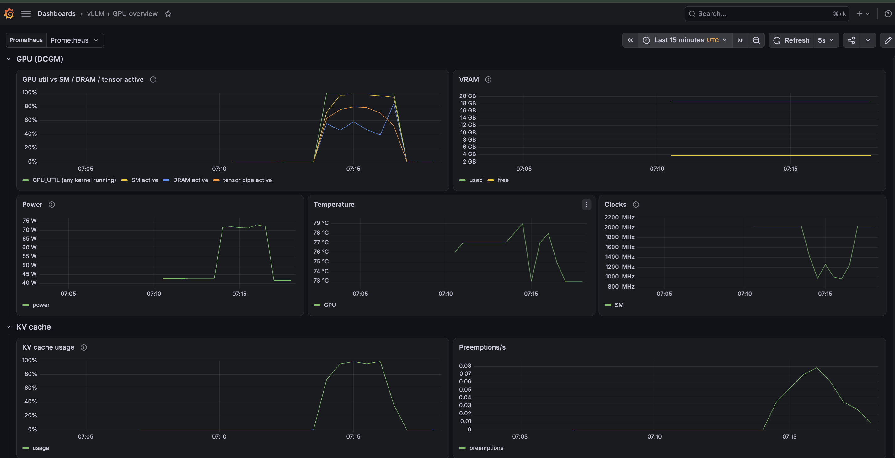

# inference-service-vllm

Hands-on research lab for **LLM inference infrastructure**: how concurrency, context length, output length and KV-cache pressure affect latency, throughput and GPU utilization of a vLLM server.

> Status: **core performance experiments done (Exp0–Exp3), KV-capacity intervention done (Exp4A), monitoring installed. Next: restart / recovery under load (Exp5), then final README and project freeze.** vLLM runs on GKE (1 × L4); the load generator is validated against `vllm bench serve` ([report](docs/experiments/VALIDATION_VLLM_BENCH.md)). New performance experiments are frozen; open questions are in [Future work](docs/ROADMAP.md#future-work). No numbers are claimed without an experiment report in `docs/experiments/`.

## Research question

How do latency (TTFT, TPOT, p95), throughput and GPU/VRAM usage change as the shape of the inference workload changes?

## Architecture (MVP)

```text
Python async load generator ──HTTP (OpenAI-compatible)──▶ vLLM server ──▶ 1 × NVIDIA GPU
          │                                                  │
          └── raw JSONL per request                          └── /metrics (Prometheus)
```

vLLM runs as a Deployment + ClusterIP Service on GKE (`k8s/serving/`); the load generator runs in a separate Pod on the system node (`k8s/bench/`), so measurements do not go through a laptop or port-forward. Experiment numbers come from the client's raw records and its own 1 s `/metrics` snapshots; Prometheus and Grafana (below) are for watching runs.

## Core experiments

| ID | Question | Status |
|---|---|---|
| [Exp000](docs/experiments/EXP_000_FIRST_REQUEST.md) | First measured request (c=1): TTFT p50 81 ms, TPOT 56.6 ms on L4 | done |
| [Validation](docs/experiments/VALIDATION_VLLM_BENCH.md) | Load generator vs `vllm bench serve` (c=8, 512→128): means agree within 0–3.5% | done |
| [Exp0](docs/experiments/EXP_001_BASELINE.md) | Baseline at concurrency = 1: TTFT p50 170 ms, TPOT 56.6 ms, run-to-run spread < 1% | done |
| [Exp1](docs/experiments/EXP_002_CONCURRENCY.md) | Concurrency scaling: 17 → 485 tok/s, KV-limited saturation begins around c ≈ 96 (~86 sequences running) | done |
| [Exp2](docs/experiments/EXP_003_CONTEXT_LENGTH.md) | Context length (128–7168 → 128): prefill ≈ 0.28 ms/token; saturation shifts to c ≈ 48 / 25 / 12 for P = 1024 / 2048 / 4096 at ~50k KV tokens, as predicted from KV capacity | done |
| [Exp3](docs/experiments/EXP_004_OUTPUT_LENGTH.md) | Output length (512 → 32–1024): O=512 saturates at ~64 running (c ≈ 64–72) with 4–5× more preemptions than O=128 and falling throughput past the boundary; O=32 saturates without KV pressure (KV ≤ 0.8), approaching the prefill limit at ~6 req/s | done |
| [Exp4](docs/experiments/EXP_005_KV_PRESSURE.md) | KV-cache capacity as an intervention (P=2048, pool 0.5× / 0.75× / 1× via block override): the admission boundary follows the pool, plateau ≈ (K − P) / F running (98–100%); throughput grows slower (×1.31 for ×2 pool) because TPOT grows with running; FP8 KV not run | done (bf16) |
| [Exp5](docs/experiments/EXP_006_RESTART_UNDER_LOAD.md) | Pod restart under load (open loop, 1 req/s): failures with and without client retries, startup phases, readiness, recovery; cold start (R0), Pod deletion (R1), container restart (R2) | planned: design and tooling ready |

## Monitoring

Self-hosted kube-prometheus-stack (Prometheus, Grafana) on a separate node pool; vLLM `/metrics` and GPU metrics from GKE's managed dcgm-exporter, both at 5 s; one dashboard from load to GPU to KV to latency. Monitoring overhead on the benchmark: < 0.3%. Design, install notes and more screenshots: [docs/MONITORING.md](docs/MONITORING.md), [monitoring/README.md](monitoring/README.md).



## Repository layout

```text
client/        load generator, request model, /metrics snapshots, mock vLLM server
analysis/      aggregation, percentiles, plots, comparison with vllm bench serve, restart timeline
configs/       scenario YAML (configs/scenarios/)
k8s/           cluster notes, vLLM Deployment/Service, benchmark client Pod
scripts/       smoke test, environment capture, in-cluster benchmark runner, fault injection
monitoring/    Prometheus / Grafana
results/       raw (JSONL) → aggregated → figures
docs/          concepts, protocol, environment, experiment reports
```

## Docs

- [Execution plan](docs/ROADMAP.md)
- [Inference concepts](docs/INFERENCE_CONCEPTS.md)
- [Experiment protocol](docs/EXPERIMENT_PROTOCOL.md)
- [Environment](docs/ENVIRONMENT.md)
- [Load generator](docs/LOAD_GENERATOR.md)
- [Monitoring](docs/MONITORING.md)
- [Future work](docs/ROADMAP.md#future-work)

## Local setup

```bash
uv sync --all-extras   # client + analysis + dev tools
uv run pytest
```

Running vLLM on GKE: [`k8s/standalone/README.md`](k8s/standalone/README.md) (first bring-up), [`k8s/serving/vllm.yaml`](k8s/serving/vllm.yaml) (Deployment + Service). Running benchmarks: [docs/LOAD_GENERATOR.md](docs/LOAD_GENERATOR.md).
